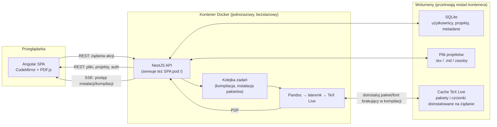

  

<h1 align="center">TxWrite</h1>

  TxWrite to samodzielnie hostowany edytor LaTeX i Markdown w przeglądarce, z podglądem PDF na żywo.
  Działa jako jeden kontener Docker — bez potrzeby lokalnej instalacji TeX-a — i leniwie
  doinstalowuje brakujące pakiety LaTeX oraz czcionki przy pierwszym użyciu, dzięki czemu
  obraz bazowy pozostaje mały, a jednocześnie wspiera dowolne pakiety. Użytkownicy rejestrują się,
  organizują pracę w profile i projekty, edytują pliki <code>.tex</code>/<code>.md</code> w edytorze
  opartym na CodeMirror z paskiem narzędzi dopasowanym do LaTeX-a, a następnie kompilują do PDF
  z informacją o postępie w czasie rzeczywistym.

<!-- TODO: wstaw tutaj demo nagranie (mp4) z przejściem przez główny interfejs -->

## Funkcjonalności

### Logowanie i profile

- Rejestracja e-mail/hasło z 6-cyfrowym kodem weryfikacyjnym wysyłanym mailem (przez SMTP, logowanym do konsoli jeśli SMTP nie jest skonfigurowane), wymaganym przed pierwszą sesją
- Logowanie, wylogowanie i ciche odświeżanie sesji za pomocą tokenów JWT (access/refresh) przechowywanych w ciasteczkach httpOnly
- Ponowne wysłanie kodu weryfikacyjnego
- Wybór profilu: tworzenie/wybór "profili" — nazwanych grup projektów — w ramach jednego zalogowanego konta
- Lista projektów w profilu: tworzenie, zmiana nazwy i usuwanie projektów

### Projekty i pliki

- Przestrzeń pracy projektu z drzewem plików: tworzenie, zmiana nazwy, usuwanie, wgrywanie oraz przenoszenie plików metodą "przeciągnij i upuść"
- Obsługa plików `.tex`, `.md`, `.bib`, `.cls`, `.sty`, obrazów (PNG/JPG/PDF/SVG), czcionek (TTF/OTF) i innych zasobów
- Import i eksport całego projektu jako archiwum ZIP
- Ustawienia na poziomie projektu: silnik kompilacji, plik główny, typ szablonu, wybór szablonu Markdown

### Edytor

- Edytor oparty na CodeMirror 6 z podświetlaniem składni LaTeX i Markdown
- Pasek narzędzi do poziomów nagłówków, skategoryzowane menu symboli matematycznych (litery greckie, strzałki, operatory, relacje), wstawianie rysunków/tabel/list, linków, surowego LaTeX-a i fragmentów szablonów
- Panel konspektu dokumentu, który analizuje nagłówki/sekcje i przenosi kursor do wybranego miejsca
- Obsługa cofania/ponawiania zmian (undo/redo)

### Kompilacja i podgląd

- Kompilacja manualna lub automatyczna, z przełącznikiem zapamiętywanym między projektami
- Kompilacja plików `.tex` przez `latexmk` (pdflatex/xelatex/lualatex) z wykrywaniem magicznych komentarzy
- Kompilacja plików `.md` przez Pandoc → pośredni plik `.tex` → `latexmk`, dzięki czemu Markdown korzysta z tego samego mechanizmu bibliografii/ponownych prób co natywny LaTeX
- Podgląd PDF na żywo z ostatnio skompilowanym wynikiem
- Ustrukturyzowany log kompilacji z klikalnymi błędami przenoszącymi do odpowiedniej linii
- Pasek statusu w czasie rzeczywistym (poprzez Server-Sent Events) pokazujący instalację pakietów, pobieranie czcionek i postęp kompilacji
- Skanowanie w tle (prefetch) edytowanej treści, które proaktywnie instaluje prawdopodobnie potrzebne pakiety/czcionki, zanim kompilacja się nie powiedzie

### Eksport

- Eksport skompilowanego dokumentu do PDF, Markdown, LaTeX, HTML lub Word (.docx)
- Eksport całego projektu jako ZIP

### Lokalizacja

- Interfejs przygotowany przede wszystkim w języku polskim, obsługiwany przez dedykowany serwis/pipe tłumaczeń

> Jeszcze niezaimplementowane (śledzone w `docs/currentwork/plan.md`): logowanie OIDC (Google/Keycloak), galeria szablonów, współpraca wielu użytkowników w czasie rzeczywistym oraz historia wersji.

## Zastosowane technologie i główny koncept architektoniczny

Całość działa jako jeden kontener Docker, w którym backend **NestJS** serwuje zarówno API, jak i zbudowaną aplikację frontendową (**Angular** + edytor **CodeMirror 6** + podgląd PDF przez **PDF.js**). Komunikacja między nimi to zwykłe REST-owe żądania plus jeden strumień **Server-Sent Events**, którym backend wysyła do interfejsu na żywo informacje o postępie instalacji pakietów i kompilacji.

Dane trafiają do lekkiej bazy **SQLite**, a same pliki projektów leżą po prostu na dysku, w folderach per-projekt. Logowanie oparte jest na tokenach **JWT** w bezpiecznych ciasteczkach.

Za kompilację dokumentów odpowiada klasyczny, sprawdzony łańcuch narzędzi LaTeX-owych: **TeX Live** + **latexmk** zajmują się `.tex`, a pliki `.md` najpierw przechodzą przez **Pandoc**, który zamienia je na LaTeX — więc od tego momentu obie ścieżki (LaTeX i Markdown) kompilują się tym samym mechanizmem. Jeśli w dokumencie użyty zostanie pakiet lub czcionka, których kontener jeszcze nie ma, system dogrywa je automatycznie w tle, zamiast wymagać ręcznej instalacji — dzięki temu sam obraz kontenera może pozostać mały, a jednocześnie wsparcie pakietów jest praktycznie nieograniczone.

Dzięki temu, że cała konfiguracja, pliki użytkownika i zainstalowane dodatki żyją poza obrazem (w wolumenach Dockera), kontener można w każdej chwili zrestartować lub odtworzyć od zera bez utraty danych — a całe środowisko stawia się jedną komendą `docker compose up`, bez ręcznej instalacji LaTeX-a na komputerze użytkownika.
